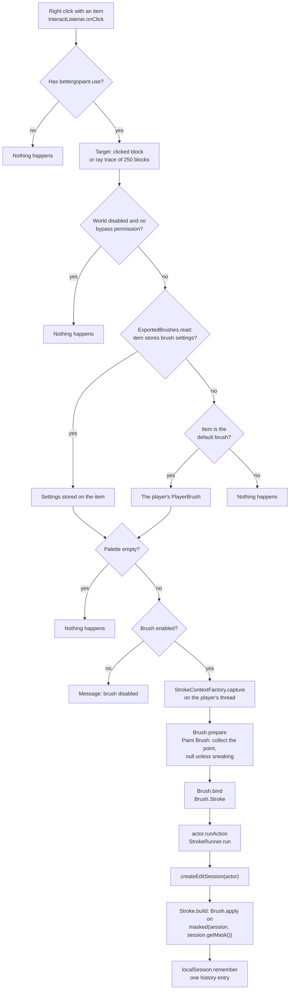

# How a brush stroke is applied

A right-click with the brush item goes through the steps below. The flowchart shows the order of the checks and
the classes that perform them.

The steps in order:

1. **Permission and world check.** The player needs `bettergopaint.use`. Worlds listed in
   `generic.disabled-worlds` are skipped unless the player has `bettergopaint.world.bypass`.
2. **Target.** Clicking a block uses that block. Clicking into the air ray-traces up to 250 blocks.
3. **Settings.** The default brush item uses the player's own brush. Any other item that stores brush settings
   uses them: the settings are in the item's data, and an item from BetterGoPaint 1.x keeps them in its lore
   until its first right-click converts it (see [Share a brush as an item](../how-to/share-a-brush-as-an-item.md)).
   Any other item does nothing.
4. **Stroke context.** Still on the player's thread, the plugin captures everything the brush
   needs into an immutable stroke context: the target position, the position of the player's eyes
   (for the relative surface mode), a snapshot of the brush settings, the palette as a WorldEdit
   random pattern, the mask as a WorldEdit mask and a random generator seeded for this stroke.
   Materials are converted to WorldEdit block types here, once per stroke. The Paint Brush also
   collects its clicked points at this step and queues nothing until you sneak.
5. **Edit.** The stroke runs in WorldEdit's action queue, inside an edit session of the player's own
   WorldEdit session. The brush reads and writes blocks only through that edit session and never asks
   Bukkit for a world, block or location, so it is safe off the main thread. A brush reads everything it
   needs first and writes afterwards, so a block it has already changed cannot influence which block it
   picks next.

Because the stroke uses the player's WorldEdit session:

- **Undo.** The whole stroke is one history entry, so one `//undo` takes back everything a click
  painted.
- **Global mask.** A mask set with `//gmask` applies to brush strokes. With `//gmask grass_block`
  a sphere over grass and stone only changes the grass.
- **Limits.** The block change limit and the other FastAsyncWorldEdit limits of the player apply.

The BetterGoPaint mask from the brush menu is a separate, additional filter: with it enabled a
stroke only changes blocks of the mask type. A block has to pass both masks.

Brush settings live in memory per player and are dropped when the player leaves the server.
