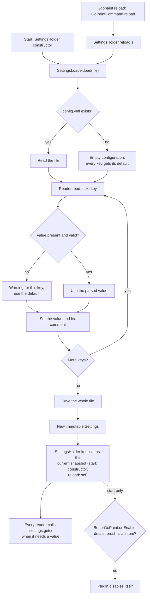

# How settings are loaded

BetterGoPaint reads `config.yml` once on start and again on every `/gopaint reload`. Each read
produces a complete, fixed snapshot of all values. The plugin swaps the old snapshot for the new
one in one step, so a builder never paints with half-old, half-new settings.

## Invalid values

The file is read key by key. A value that cannot be used, such as text where a number belongs or a
material that does not exist, does not stop the plugin. That key gets its default and the console
shows one warning for each such key. Then BetterGoPaint writes the whole file back with every key, its
effective value and its comment, which is how new keys appear after an update.

The brush item is the exception. If `generic.default-brush` names a material that cannot be held as
an item, nobody can hold the brush. On start the plugin then disables itself; after a reload it
keeps running, but painting with the default brush is impossible until the value is fixed.

## What a reload changes

A reload affects everything that is read when it is used: the brush item, disabled worlds, the
prefix and every maximum. Builders who already have a brush keep their current size, mask and
other choices; the new `default-*` values apply to builders who pick up a brush for the first time
after the reload, for example after rejoining.

Two keys are read only on start, so changing them needs a restart:

- `generic.languages`, because translations are registered once.
- `generic.check-for-updates`, because the update check is scheduled once.
