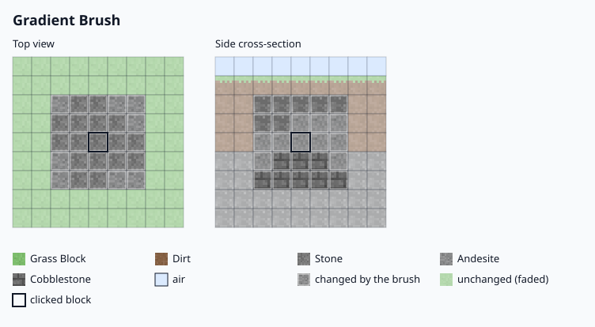

# Blend a gradient

Paint a sphere of blocks in bands, one band per palette block, from the bottom of the brush up to its top.

## What you need

- The brush item and the `bettergopaint.use` permission.
- Two or more blocks for the palette, in the order you want them from bottom to top. See
  [Mix a block palette](mix-a-block-palette.md).

## Steps

1. Left-click the brush item to open the brush menu.
2. Shift-click the **Selected Brush type** item, then click **Gradient Brush** in the list.
3. Arrange the palette. Palette slot 1 (slot 46) is the bottom band, the last palette slot is the top band.
4. Left-click the **Falloff Strength** item (slot 12) to raise it by 10%, right-click to lower it. The default is 50%.
5. Left-click the **Mixing Strength** item (slot 13) to raise it by 10%, right-click to lower it. The default is 50%.
6. Set the size with the **Brush Size** item (slot 14). Left-click raises it by 1, right-click lowers it by 1,
   shift-click changes it by 10.
7. Close the menu and right-click the ground.


Planned screenshot: `images/screenshots/gradient-mixing.png`, see the shotlist.


## What the settings do

- **Falloff Strength** sets how much of the sphere stays solid. Blocks near the edge are left out at random,
  and the share left out grows toward the edge. At 0% the sphere is solid up to its edge.
- **Mixing Strength** moves the border between two bands at random. At 0% the bands have sharp borders. At 100%
  neighbouring blocks mix at the borders.

The gradient does not pick blocks at random. The slot order sets the bands, and the chance percentages in the
menu do not apply to it.

## Related

- [Brushes](../reference/brushes.md) lists the settings of every brush.
- [Brush menu](../reference/brush-menu.md) gives the slot of each menu item.
