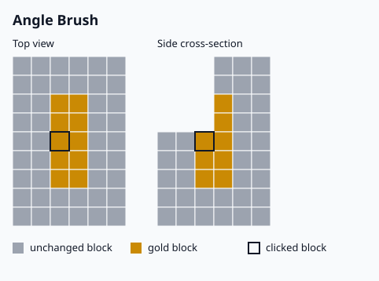

# Shape cliffs with the Angle brush

Paint only the steep faces of a cliff, and leave the flat ground and the gentle slopes unchanged.

## What you need

- The brush item and the `bettergopaint.use` permission.
- A palette with the block you want on the cliff face. See [Mix a block palette](mix-a-block-palette.md).

## Steps

1. Left-click the brush item to open the brush menu.
2. Shift-click the **Selected Brush type** item, then click **Angle Brush** in the list.
3. Left-click the **Angle Check Distance** item (slot 12) to raise it. Right-click to lower it. The range is 1 to 5, the default is 2.
4. Left-click the **Maximum Angle** item (slot 13) to raise the angle by 5 degrees. Right-click to lower it by 5. Shift-click to change it by 15. The range is 10.0 to 85.0, the default is 40.0.
5. Close the menu and right-click the foot of the cliff, or the face itself.


Planned screenshot: `images/screenshots/angle-cliff-before-after.png`, see the shotlist.


## How the two settings act

- The brush measures the slope over the check distance. A block is painted when its slope is at least the
  angle in **Maximum Angle**. A higher angle paints fewer blocks, and only the steeper faces.
- Ground that is almost flat is never painted, whatever the angle.
- The slope is measured across the check distance on both sides of the block.

The label says *Maximum Angle*, but the value is the smallest slope that is painted.

## Related

- [Brushes](../reference/brushes.md) lists the settings of every brush.
- [Brush menu](../reference/brush-menu.md) gives the slot of each menu item.
