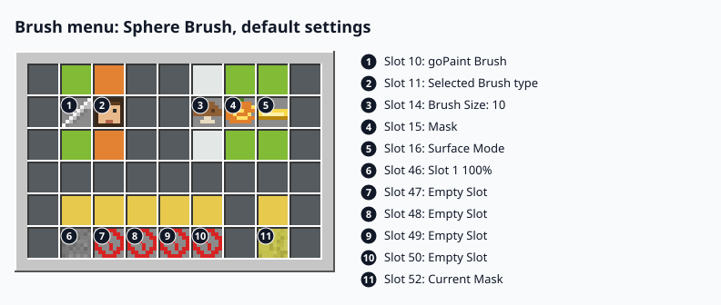
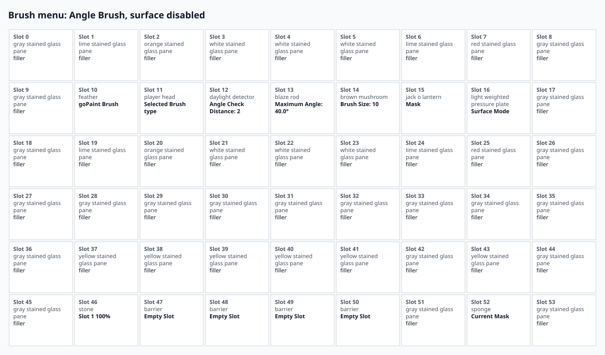
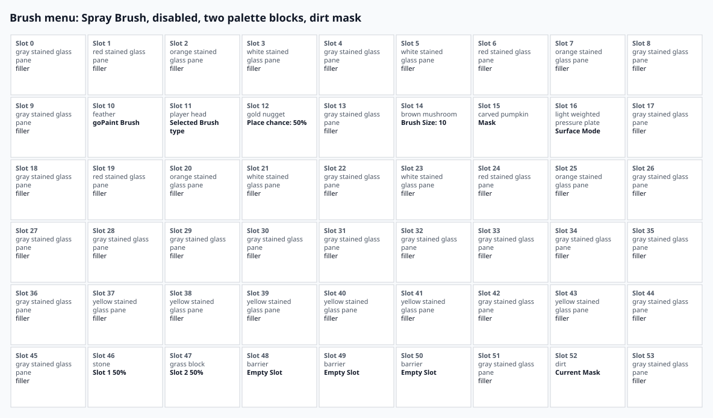

# Brush menu

The brush menu opens with a left-click on the brush item. It has 54 slots in six rows of nine. Slots are
numbered from 0 at the top left, the same numbers as the labels in the pictures below. The palette has five
slots, numbered 1 to 5 in the menu, which are slots 46 to 50 of the menu.

Review note: this table is written by hand from the section comments of `GUI.java` and the click handler of
`InventoryListener`. The pictures are generated from the code. When the layout changes, update this table and
regenerate the pictures with `./gradlew generateDocsImages`.

## Pictures

The default settings, with the Sphere Brush selected:

The Angle brush, with its two extra settings in slots 12 and 13:

The Spray brush with the mask turned off and two palette blocks:

## Slots

| Slot | Item | Shows | Click |
|---|---|---|---|
| 10 | Brush item (feather, "goPaint Brush") | Enabled or Disabled | Right-click toggles the brush. Left-click with a non-block item that is not the brush item stores the brush on that item. |
| 11 | Selected Brush type | The brush list, the selected brush highlighted | Left-click: next brush. Right-click: previous brush. Shift-click: brush picker. |
| 12 | Setting 1 of the brush | See the table of settings below | Left-click raises, right-click lowers. Disc brush: click cycles the axis. |
| 13 | Setting 2 of the brush | Maximum Angle (Angle brush) or Mixing Strength (Gradient brush) | Left-click raises, right-click lowers. Angle brush: shift-click changes by 15. |
| 14 | Brush Size | Brush size | Left-click +1, right-click -1, shift-left +10, shift-right -10. |
| 15 | Mask | Enabled (jack o'lantern) or Disabled (carved pumpkin) | Click toggles the mask. |
| 16 | Surface Mode | Direct, Relative or Disabled | Click cycles Direct, Relative, Disabled. |
| 37 to 41 | Yellow panes above the palette | Nothing | Act as palette slots 1 to 5, as slots 46 to 50 do. |
| 43 | Yellow pane beside the palette | Nothing | Left-click with a solid block sets the mask block. |
| 46 to 50 | Palette slots 1 to 5 | The block and its chance, or a barrier when empty | Left-click with a solid block adds the block, or replaces it. Right-click clears the slot. |
| 52 | Current Mask | The mask block | Left-click with a solid block sets the mask block. |

The panes above and below slots 10 to 16 (slots 1 to 7 and 19 to 25) act like the item in their column. All
other slots are fillers: a click does nothing.

## Settings and their ranges

Steps are per click. Shift-click is listed where it changes the step.

| Setting | Item | Range | Default | Step |
|---|---|---|---|---|
| Place chance | Spray brush, slot 12 | 10 to 100 % | 50 % | 10 |
| Axis | Disc brush, slot 12 | X, Y or Z | Y | cycles X, Y, Z |
| Layer thickness | Overlay and Underlay brushes, slot 12 | 1 to 5 | 1 | 1 |
| Fracture check distance | Fracture brush, slot 12 | 1 to 5 | 2 | 1 |
| Angle check distance | Angle brush, slot 12 | 1 to 5 | 2 | 1 |
| Falloff strength | Splatter, Paint and Gradient brushes, slot 12 | 0 to 100 % | 50 % | 10 |
| Maximum angle | Angle brush, slot 13 | 10.0 to 85.0 degrees | 40.0 | 5, or 15 with shift |
| Mixing strength | Gradient brush, slot 13 | 0 to 100 % | 50 % | 10 |
| Brush size | All brushes, slot 14 | 1 to 100 | 10 | 1, or 10 with shift |
| Palette chance | Palette slots 46 to 50 | 100 divided by the number of blocks, rounded down | — | — |

The maximums of thickness, angle check distance, fracture distance and brush size, and the defaults, can be
changed in `config.yml`. See [Configuration](configuration.md).
