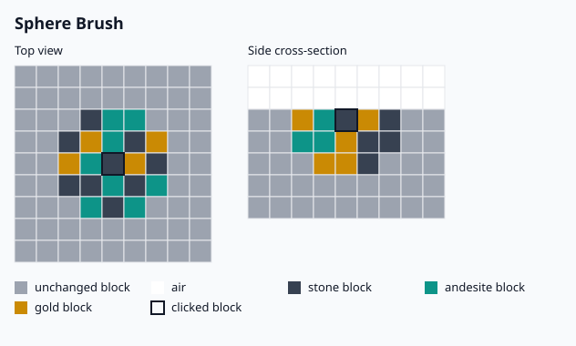
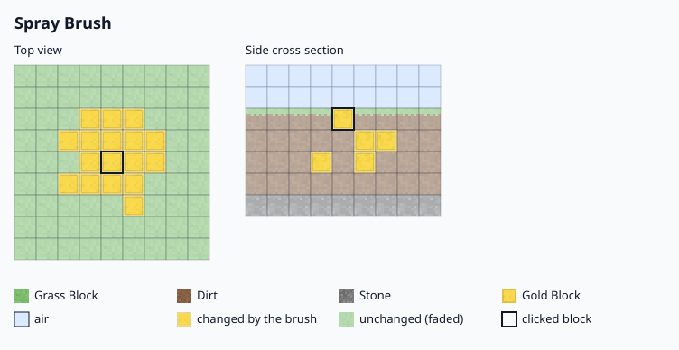
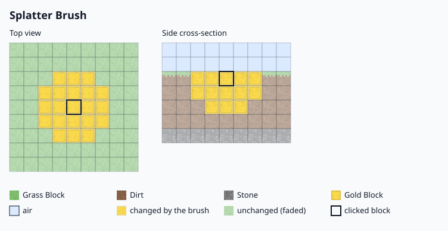
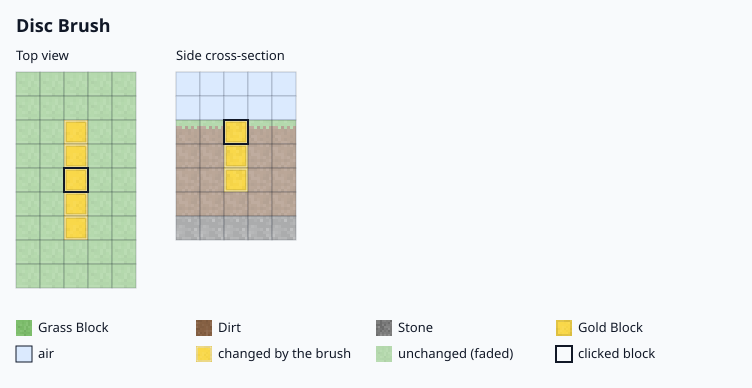
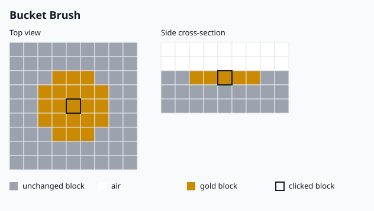
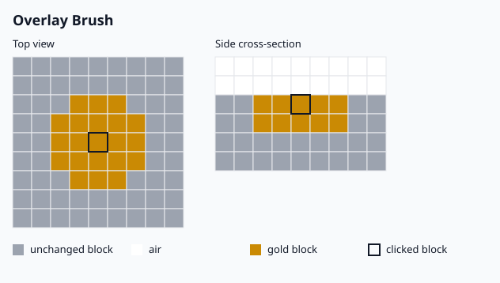
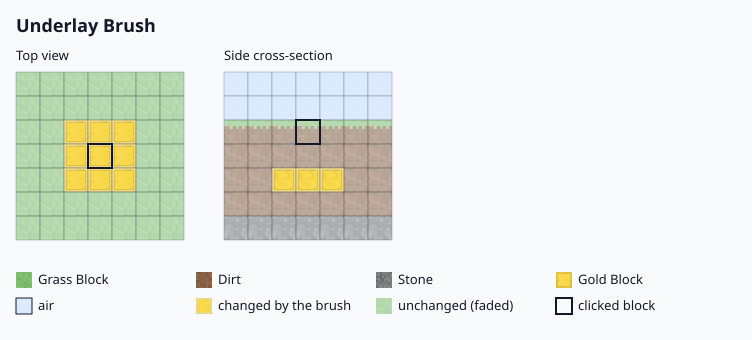
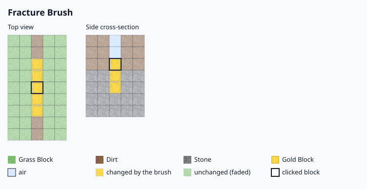
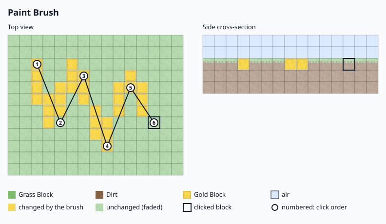

# Brushes

Every brush places blocks from the palette. The brush decides which positions are painted.
Settings that a brush does not use are hidden in the menu.

| Brush | Paints | Extra setting |
|---|---|---|
| Sphere Brush | Every block in a sphere around the clicked block. | — |
| Spray Brush | Random blocks in the sphere. | Chance |
| Splatter Brush | Random blocks, more likely close to the clicked block. | Falloff |
| Disc Brush | A flat disc on one axis through the clicked block. | Axis |
| Bucket Brush | Connected blocks of the same type as the clicked block. | — |
| Angle Brush | Only steep faces such as cliffs. | Angle distance, angle height difference |
| Overlay Brush | Blocks with air above them. | Thickness |
| Underlay Brush | Blocks without air above them. | Thickness |
| Fracture Brush | Cracks and fissures. | Fracture distance |
| Gradient Brush | A gradient that blends the palette blocks into each other. | Mixing, falloff |
| Paint Brush | Strokes along a curve through every point you click; sneak to finish the stroke. | Falloff |

The Paint Brush keeps at most 256 points of one stroke. A click past that limit is refused with a message;
sneak and click to paint the stroke with the 256 points it already holds.

Settings shared by all brushes: size and mask (only replace the mask block). The surface mode
(`DIRECT`, `RELATIVE`, `DISABLED`) applies to every brush except Overlay, Underlay and Fracture. Strokes also
respect the global mask of the builder's WorldEdit session (`//gmask`). Defaults and limits are in
[Configuration](configuration.md). The menu slots of these settings are in [Brush menu](brush-menu.md).

## Shapes

Each picture shows the shape from the top and as a cross-section through the clicked block. The legend in
each picture names the colours of the painted, unchanged and air blocks and of the clicked block.

### Sphere Brush

### Spray Brush

### Splatter Brush

### Disc Brush

### Bucket Brush

### Angle Brush

### Overlay Brush

### Underlay Brush

### Fracture Brush

### Gradient Brush

### Paint Brush

